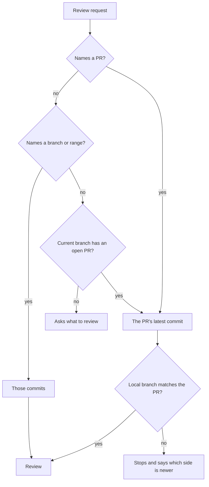
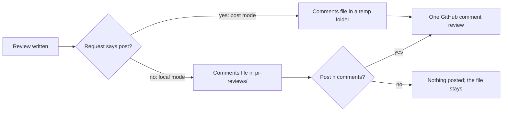
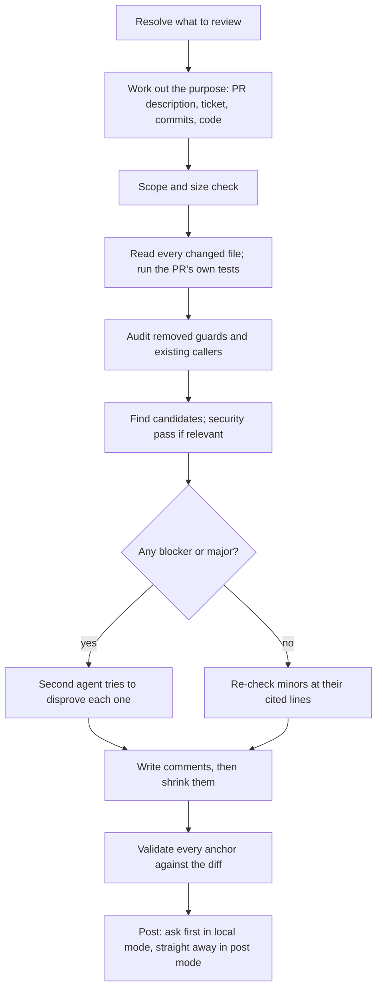

# pr-reviewer

**A Claude Code skill that reviews pull requests like a senior engineer, and writes comments like one.**

[](LICENSE)
[](https://claude.com/claude-code)

Ask Claude to review a PR. You get a short list of high-confidence comments, each pinned to the exact line it belongs on, written the way a teammate would type them. One "yes" posts them all to GitHub as a single review. In a cloud run, it posts them straight away.

## Quick start

1. In Claude Code, add the plugin:

   ```
   /plugin marketplace add coderdeep11/claude-pr-reviewer
   /plugin install pr-reviewer@claude-pr-reviewer
   ```

2. Open Claude Code in the repo you want reviewed. Check that `gh auth status` says you're logged in.
3. Ask: `review PR #482`.
4. Read the summary, then answer **"Post 3 comments to #482?"**

---

## Why use it

Most AI review output has the same problems: comments on the wrong line, confident claims that turn out false, and long, polite paragraphs nobody reads. This skill is built around fixing those.

| Problem | What pr-reviewer does |
| --- | --- |
| Comments land on the wrong line | Line numbers come straight from the diff, never from counting. A script rejects any anchor that isn't a line the PR added. |
| Confident but wrong findings | Every `blocker` and `major` goes to a second agent whose only job is to disprove it. Refuted findings are dropped. |
| Walls of generated prose | A built-in style guide and a mandatory "shrink pass" cut each comment to what a teammate would type in 30 seconds. |
| Pretends it read everything | A coverage line lists what was read in full, skimmed, and not opened, with the reason. |
| Reviews code the PR didn't touch | Comments must anchor to the change. Pre-existing issues are noted as "checked and fine", not raised. |
| Reviews whatever is checked out | It reviews only a PR or a branch you name, and only committed code. Otherwise it asks. |
| Too eager to change things | Strictly read-only. It never commits, pushes, checks out, or edits your code. |

### The difference in one comment

Typical AI review comment:

> The `jti` replay check is check-then-write, so two concurrent requests with the same assertion can both pass `exist?` before either write happens. Could we switch to an atomic add and fail closed if the write isn't accepted? Otherwise the replay guarantee here is weaker than the docs imply.

pr-reviewer:

> This check-then-write isn't atomic: two requests with the same `jti` both pass `exist?` before either writes. Can we use an atomic add (`unless_exist: true`) and fail closed if it's already set?

And for small things, it's as short as a person would be:

> why `:original`? other serializers use `:large_icon` for logos.

---

## Add it

| You want | Use |
| --- | --- |
| It for yourself, in every repo, with easy updates | Option 1 |
| It turned on for everyone working in a repo | Option 1, with the repo settings |
| Cloud runs, or the skill versioned with your code | Option 2 |
| It for yourself, without the plugin system | Option 3 |

### Option 1: Plugin (recommended)

Run these in Claude Code:

```
/plugin marketplace add coderdeep11/claude-pr-reviewer
/plugin install pr-reviewer@claude-pr-reviewer
```

**Check it's installed:** run `/plugin` and press Tab to reach the Installed tab.

**Update:** in `/plugin`, open the Installed tab and choose "Update now". From a shell: `claude plugin update pr-reviewer@claude-pr-reviewer`. This marketplace doesn't auto-update by default; to turn that on, open `/plugin`, go to the Marketplaces tab and choose "Enable auto-update".

**Remove:** `claude plugin uninstall pr-reviewer@claude-pr-reviewer`.

**Turn it on for a whole repo.** Commit this to the repo's `.claude/settings.json` to register the marketplace and enable the plugin for everyone working in that repo:

```json
{
  "extraKnownMarketplaces": {
    "claude-pr-reviewer": {
      "source": { "source": "github", "repo": "coderdeep11/claude-pr-reviewer" }
    }
  },
  "enabledPlugins": {
    "pr-reviewer@claude-pr-reviewer": true
  }
}
```

### Option 2: Copy into your codebase

The skill is versioned with your code, and everyone who clones the repo gets it. Use this for cloud runs. From the repo root:

```bash
tmp=$(mktemp -d)
git clone --depth 1 https://github.com/coderdeep11/claude-pr-reviewer "$tmp"
mkdir -p .claude/skills
rm -rf .claude/skills/pr-reviewer
cp -R "$tmp/plugins/pr-reviewer/skills/pr-reviewer" .claude/skills/
rm -rf "$tmp"
grep -qx "pr-reviews/" .gitignore 2>/dev/null || echo "pr-reviews/" >> .gitignore
```

Commit `.claude/skills/pr-reviewer/` and the `.gitignore` change. To update, run the same commands again.

### Option 3: Just for you, in every repo

Same as Option 2, but copy to `~/.claude/skills/` instead of `.claude/skills/`, and skip the commit.

### Requirements

| Tool | Needed for |
| --- | --- |
| [Claude Code](https://claude.com/claude-code) | running the skill |
| `git`, `bash`, `awk` | reading the diff and validating anchors |
| [`gh`](https://cli.github.com), logged in | PR context, CI status, existing comments, posting |
| `jq` | posting the review |
| Atlassian MCP (optional) | checking the PR against its Jira ticket |

Without `gh`, you can still review a named branch or commit range. Without the Atlassian MCP, the review works from the PR alone and says so.

---

## Use it

1. Open Claude Code in the repo. Commit your changes; uncommitted code is not reviewed. For a PR, push them too.
2. Ask for a review in plain words. Claude picks the skill up on its own:

   ```
   review PR #482
   review https://github.com/acme/api/pull/482
   review this branch against main
   review main...feature/invoice-export
   review and post PR #482
   ```

   Or call it directly: `/pr-reviewer:pr-reviewer` with the plugin, `/pr-reviewer` if you copied it in.
3. Read the summary in chat. The full comments are in `pr-reviews/<branch>.md`.
4. Answer **"Post 3 comments to #482?"** Yes posts one GitHub review. No keeps the file, so you can edit it or paste comments by hand.
5. After the author pushes fixes, ask again. The new review says which earlier comments are resolved.

### What it reviews



- **Committed code only.** Uncommitted and untracked changes are never reviewed. The summary says when it left some out.
- **A named branch with no base** is compared with the repo's default branch.
- **No description and no ticket?** It works out what the PR does from the commits and the code, and marks that as inferred.

### Local mode and post mode



- **Local mode (default):** the steps in "Use it" above. The file stays in `pr-reviews/`, and Claude asks before it posts.
- **Post mode:** say "post" in the request. Nothing is written into the repo, and the comments go straight to the PR.

Either way, it posts a plain comment review. It never approves or requests changes; that stays a person's call.

### Running it in the cloud

Any runner that starts Claude Code in a checkout of the repo works the same way:

1. Install the skill with Option 2, so the run finds it in the checkout.
2. Log `gh` in with a token that can write pull request reviews. In GitHub Actions, pass it as `GH_TOKEN` and grant `pull-requests: write`.
3. Ask for post mode in the prompt: `review and post PR #482`.

A cloud run has no one to answer questions. If the review needs to ask something, such as which PR to review, it stops, posts nothing, and says why in the run output. If it finds nothing to comment on, it also posts nothing.

### Example output

<details>
<summary><code>pr-reviews/invoice-export.md</code></summary>

````markdown
# PR Review: Add CSV export to invoices

**What this PR does:** Adds a CSV export endpoint for invoices and an Export button on the invoices page.

**Recommendation: request changes.** The export isn't scoped to the current account, so any signed-in user can download another account's invoices.

**Coverage:** read in full: app/controllers/invoices_controller.rb, app/services/invoice_csv.rb, spec/requests/invoices_spec.rb; skimmed: app/views/invoices/index.html.erb; not opened: none.

**Tests run:** bundle exec rspec spec/requests/invoices_spec.rb: 6 examples, 0 failures.

**Verification:** 2 sent to the verifier: 2 confirmed, 0 plausible, 0 refuted and dropped. Gap sweep found 0.

**Claims checked:** "export only includes the current account's invoices": false, app/controllers/invoices_controller.rb:42 queries `Invoice.where(id: params[:ids])`.

**Ticket:** BILL-214: export filtered invoices as CSV: covered, app/services/invoice_csv.rb:8.

---

## 1. [blocker] inline app/controllers/invoices_controller.rb:42

> this isn't scoped to the account, so any invoice id works. Use `current_account.invoices`.
>
> ```suggestion
>     invoices = current_account.invoices.where(id: params[:ids])
> ```

## 2. [major] inline app/services/invoice_csv.rb:15

> `invoice.customer.name` runs per row and nothing preloads `customer`, so big exports N+1. Can we `includes(:customer)` in the controller?

## 3. [nit] inline app/services/invoice_csv.rb:3

> drop the leftover `puts`.
````

</details>

`suggestion` blocks become GitHub's one-click "Commit suggestion" button.

---

## How it works



A few rules shape every review:

- **Read before claiming.** No function, field, or line is cited unless it was read in this session.
- **Certain, or it's a question.** If the evidence doesn't fully support a bug, it becomes a `question` or is dropped.
- **Coverage before signal.** Every substantial file is opened before the PR is judged. Large PRs are read in risk order (auth, migrations, money, shared services, public API), and the coverage line says what was skipped.
- **The repo decides taste.** Conventions come from your `CLAUDE.md`, `CONTRIBUTING.md`, linter configs, and PR template, not from the model's preferences.
- **Checks what the PR claims.** Every factual claim in the PR body, and every requirement in the linked ticket, is marked true, false, or unverifiable with a `file:line`.
- **Looks past the added lines.** It checks what the diff removed (guards, validations, tenant filters, transactions) and greps for callers the change could break.
- **Checks what the diff points at.** A new filter value or enum member must exist where it's defined. A comment must still match the code next to it. A new dependency must not do the same job as one already installed.
- **Out-of-scope files get one comment.** Unrelated changes are rolled into a single "please split this PR" note instead of a line-by-line review.

### Severity

| Severity | Meaning |
| --- | --- |
| `blocker` | Likely data loss, security or auth breach, build break, migration failure, or outage |
| `major` | Likely correctness, integrity, privacy, or scalability bug to fix before merge |
| `minor` | Real issue with limited impact, or an edge case |
| `question` | Missing context that could hide a real issue, or an unconfirmed product decision |
| `nit` | Small, meaningful improvement; never cosmetic taste |

**Recommendation:** `request changes` if there's a blocker or major, otherwise `approve`. Any minor, question, or nit comments are the author's call.

A critical security finding (SQL injection, auth bypass, an exposed credential) is verified first, then flagged in chat immediately, not left waiting in the file. A live credential is reported before the rest of the review finishes, because it needs rotating, not just removing from the branch.

### What it will and won't do

| Will | Won't |
| --- | --- |
| Read code, diffs, PR metadata, and the Jira ticket | Commit, push, fetch, check out, reset, or stash |
| Run the test files the PR adds or changes | Run the full suite or linters unless you ask |
| Write one comments file (outside the repo in post mode) | Write or edit code or tests |
| Post one comment review, after you say yes or in post mode | Approve or request changes on your behalf |

---

## Customize

| To change | Edit |
| --- | --- |
| Comment tone and length | `references/voice.md` |
| The review workflow, severity rules, checklists | `SKILL.md` |

The skill already follows your repo's written rules, so often the better fix is adding a line to your `CLAUDE.md` or `CONTRIBUTING.md`.

---

## Troubleshooting

**It asked what to review, or for a base branch**
The current branch has no open PR and the request named nothing, or a base branch is missing locally. It won't guess, and it won't `git fetch` on its own. Name the target (`review PR #482`, `review this branch against origin/develop`), or fetch the base yourself.

**It stopped because the local branch doesn't match the PR**
Your branch has commits you haven't pushed, or the PR has commits you haven't pulled. Push or pull, then ask again.

**`PR #482 head is <sha> but the review read <sha>; push or re-review first`**
New commits landed after the review, so the line numbers may have moved. Ask for a re-review. It reads the earlier comments and notes which are now resolved.

**A cloud run posted nothing**
Either it found nothing to comment on, or it needed to ask something. The run output says which.

**`not a line this diff added: path:line`**
A comment is anchored on an unchanged or deleted line. GitHub can't place it there. Move it to the nearest added line, or change it to `general`.

**`no general comment or Recommendation line to use as the review body`**
The `**Recommendation:**` line was removed from the comments file. Put it back, or add a `general` comment.

**The ticket wasn't checked**
The Jira key is read from the branch name, then the PR title, then commit messages (pattern `ABC-123`). Check that one of them has it and that the Atlassian MCP is connected.

**Review files show up in `git status`**
Add `pr-reviews/` to `.gitignore`.

---

## Repo layout

```
.claude-plugin/marketplace.json        marketplace entry
plugins/pr-reviewer/
  .claude-plugin/plugin.json           plugin manifest
  skills/pr-reviewer/
    SKILL.md                           the review workflow
    references/voice.md                comment style guide
    scripts/anchors.sh                 prints added or removed lines as path:LINE:content
    scripts/check-review.sh            validates anchors, numbering, severity order
    scripts/post-review.sh             posts the file as one GitHub review
```

## Contributing

Issues and pull requests are welcome. Before opening a PR:

```bash
claude plugin validate .
bash -n plugins/pr-reviewer/skills/pr-reviewer/scripts/*.sh
```

Bump `version` in `plugins/pr-reviewer/.claude-plugin/plugin.json` with every change. Installed copies only update when the version changes.

## License

[MIT](LICENSE)
